# trade-lifecycle-reconciliation

A deterministic, end-to-end simulation of what happens to a trade **after** someone clicks "buy":
capturing executions from three venues that all speak different formats, allocating them to
funds, instructing settlement, keeping positions, cash and P&L, and then **reconciling** all of
it against what the brokers and custodians say, so every disagreement becomes a tracked,
owned, aged exception that someone resolves.

It runs with one command, processes thousands of orders and fills, deliberately injects
realistic problems (missing trades, duplicate fills, fat-fingered quantities, failed
settlements, misbooked custody accounts and more), and measures how many it catches, how
fast, and what would have happened to the books without it.

> **What this is not.** This is not a trading desk and nothing here touches a real account.
> Every security, venue, account, price and fee is **synthetic** and invented for the
> simulation (ISIN-like codes use the unassigned `ZZ` prefix). The venue and custodian
> formats are *modelled on* real conventions (FIX 4.4, CSV trade files, JSON APIs, SWIFT
> MT-style statements) but are not conformant implementations of any real counterparty's
> interface. The author has traded personally through several brokers; none of that activity
> is used here, and nothing in this repository claims those accounts were reconciled this way.

---

## Headline results

<!-- RESULTS:START -->
_Generated by `python -m tlr all` from the run itself (seed 20260302, window 2026-03-02 to 2026-03-17). Do not edit by hand._

| What was simulated | Count |
|---|---:|
| Orders (incl. 42 rejected, 188 partially filled then cancelled) | 3,200 |
| Fills (partial fills; 2,261 orders filled in more than one piece) | 8,003 |
| Venue messages delivered (FIX, CSV, JSON) | 11,539 |
| Exact duplicate messages replayed / absorbed by idempotency | 150 / 150 |
| Account allocations booked | 6,256 |
| Custodian statements reconciled | 72 |
| Reconciliation runs | 407 |

| Reconciliation quality | Baseline | Stress (3x incidents, overlapping) |
|---|---:|---:|
| Incidents injected | 88 | 258 |
| Recall (incidents detected with the correct break type) | 100.0% | 100.0% |
| Precision (exceptions that point at a real injected problem, correctly typed) | 100.0% | 94.1% |
| False-positive exceptions | 0 | 9 |
| Mis-typed exceptions | 0 | 7 |
| Exceptions caused by 150 benign replays | 0 | 0 |
| Median / p90 detection latency (minutes) | 30.0 / 235.1 | 29.8 / 255.6 |
| Breaks still unresolved at end of window | 2 (FEE_MISMATCH x2) | 5 |

| End-of-window book error vs expected state (gross, USD) | Recon disabled | Recon enabled |
|---|---:|---:|
| Positions, trade date | $92,469,769 | $0 |
| Settled cash | $53,256,843 | $0 |
| P&L | $1,107,210 | $0 |
| Custodian cash vs expected (counterparty-side errors not yet fixed) | $2,338,831 | $15 |

**Material incident** - fat-finger 10x face on SYNT-4.25-2031 (5,000,000 booked as 50,000,000), on BONDHUB fill `BHT0000355`. With reconciliation enabled it was raised as `QUANTITY_MISMATCH` 23 minutes after the trade and the books were corrected the same day (closed 2026-03-04 17:36 UTC). With reconciliation disabled the error flowed through allocation, settlement instructions, positions and cash: at the end of the window our books still carried a 45,000,000 face position error and a $45,468,202 settled-cash error (peak $45,468,202), with P&L misstated by $233,492.
<!-- RESULTS:END -->

The **baseline** scenario places each injected problem so that no two root causes overlap,
which is the condition the classifier is designed for, and it gets all of them. The
**stress** scenario triples the incidents and lets them collide (for example, two
wrong-account bookings in the same bond on the same day, or a stale statement hiding half of one). That is where
rule-based classification breaks down, and the residual "unexplained" exceptions show up.
[ANALYSIS.md](ANALYSIS.md) walks through every one of them.

---

## Contents

1. [Post-trade in five minutes (start here if the domain is new)](#1-post-trade-in-five-minutes)
2. [What the system does, end to end](#2-what-the-system-does-end-to-end)
3. [Three venues, three formats: normalization](#3-three-venues-three-formats-normalization)
4. [How reconciliation works](#4-how-reconciliation-works)
5. [The exception queue and the ops desk](#5-the-exception-queue-and-the-ops-desk)
6. [Injecting problems and scoring the result](#6-injecting-problems-and-scoring-the-result)
7. [Results, figure by figure](#7-results-figure-by-figure)
8. [Run it](#8-run-it)
9. [Repository map](#9-repository-map)
10. [Design choices and limitations](#10-design-choices-and-limitations)

---

## 1. Post-trade in five minutes

When a portfolio manager decides to buy 10,000 shares, the decision is the easy part.
Everything that follows is called **post-trade**, and it is where most operational risk lives.

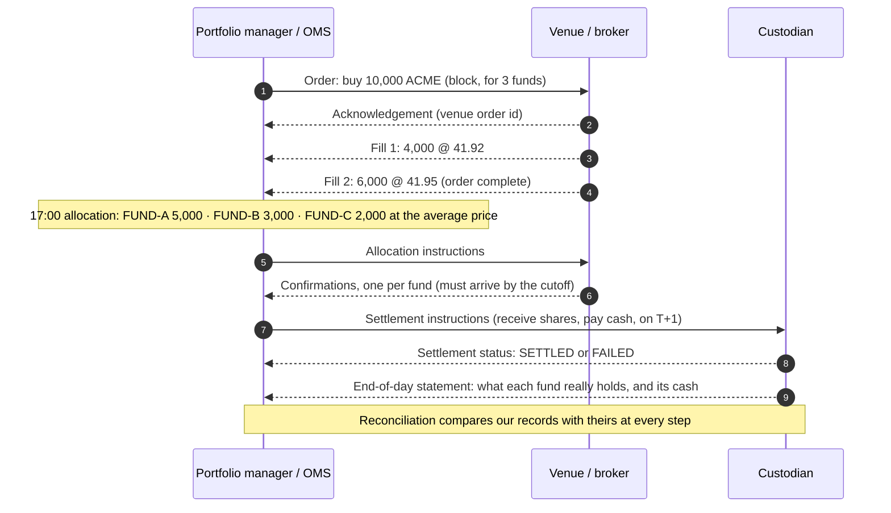

The vocabulary, in the order things happen:

| Term | Plain-English meaning |
|---|---|
| **Order** | An instruction to buy or sell, sent from our order management system (OMS) to a venue. Identified by our `client_order_id`. |
| **Venue / broker** | Where the order is executed: an exchange, a broker, or a bond trading platform. Each one has its own message format. |
| **Acknowledgement** | The venue saying "got it" and assigning its own `venue_order_id`. |
| **Fill / execution** | A piece of the order that actually traded, with a quantity, price and time. Big orders usually fill in several **partial fills**, each with its own `venue_fill_id`. |
| **Block and allocation** | One order is often placed on behalf of several funds (a *block*). After it is done, it is **allocated**: split into per-fund pieces, all at the block's average price. |
| **Confirmation** | The broker's formal statement of each allocation. Under US T+1 settlement it must be agreed the same day, so a confirmation that arrives late is itself a problem. |
| **Settlement date (T+1, T+2)** | The day securities and cash actually change hands. US equities and Treasuries settle one business day after the trade (T+1), EU securities two (T+2), skipping weekends and holidays. |
| **Settlement instruction (SSI)** | Our message to the custodian: "on this date, receive these securities and pay this cash" (RVP), or deliver and receive (DVP). |
| **Custodian / prime broker** | The institutions that actually hold the securities and cash. They are the source of truth for what you *own*. |
| **Failed settlement** | The other side did not deliver on the settlement date. The trade happened, but the shares have not arrived yet. |
| **Futures and variation margin** | Futures never exchange the full contract value. Instead, gains and losses are paid in cash every day (variation margin). |
| **Position / cash / P&L** | What each fund holds, how much cash it has, and how much it has made or lost at current prices. |
| **Reconciliation** | Systematically comparing our records with each counterparty's records, and explaining every difference. |
| **Break** | A difference that reconciliation found. Each one becomes an **exception** with a severity, an owner, an age and an audit trail. |

**Why reconciliation exists.** Every trade is recorded at least twice: once by us and once by
each counterparty. The copies drift apart all the time. Messages get dropped, re-sent,
mistyped, booked to the wrong account, settled late or charged at the wrong rate. A break that
nobody catches does not stay small. A quantity typo becomes a wrong allocation, then a wrong
settlement instruction, then a wrong position, then a wrong cash forecast and a wrong P&L.
[Section 7](#the-material-incident-what-happens-when-nobody-is-looking) shows exactly that
chain for one synthetic incident.

---

## 2. What the system does, end to end

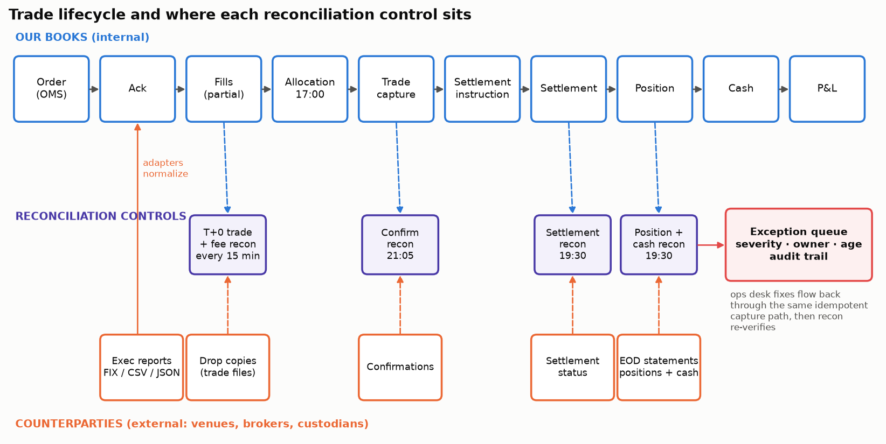

The top row is **our books**, the bottom row is **what counterparties tell us**, and the
reconciliation controls sit between them. Every component is a subscriber on one event bus:

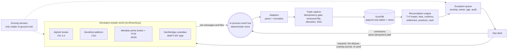

**One trading day, on the simulated clock (New York time):**

| Time | What happens |
|---|---|
| 09:35 to 15:30 | ~320 orders are created across 15 synthetic instruments (equities in USD and EUR, government and corporate bonds, two futures). |
| intraday | Venues acknowledge, partially fill, sometimes reject or cancel. Each message arrives in that venue's own format. |
| every 15 min | Venues publish drop copies (their record of every trade). **T+0 trade and fee reconciliation** runs. |
| 16:00 | Custodians report settlement status for everything due today. |
| 17:00 | **Allocation**: each block is split across funds; settlement instructions go out. |
| 17:45 | Final intraday trade reconciliation after the closing drop copies. |
| 18:30 / 19:00 | Prime broker and custodian send end-of-day statements (positions and cash per fund). |
| 19:30 | **Settlement, position and cash reconciliation.** |
| 21:05 | **Confirmation reconciliation** after the 21:00 cutoff. |
| 08:00 to 18:30 | The ops desk works the exception queue. |

The window is 10 trading days (2 to 13 March 2026) plus 2 business days for settlement to
finish. It deliberately straddles the **US daylight-saving change on 8 March**, because one
venue sends New York local times with no offset, and getting that wrong is a classic real bug.

**Lifecycle coverage.** Order, acknowledgement, partial fills, cancels and rejects,
allocation, confirmation, trade capture, settlement instruction, settlement (including
fails), positions on trade-date and settled basis, cash including bond accrued interest and
futures variation margin, P&L in USD, and reconciliation.

---

## 3. Three venues, three formats: normalization

Each counterparty describes the same kind of event differently on purpose. The adapters in
[`src/tlr/adapters/`](src/tlr/adapters) turn every one of them into the same normalized
record, and nothing downstream ever sees a venue-specific field.

**AlphaX (equity broker), FIX 4.4 tag=value.** UTC timestamps, numeric side codes, and the
venue's engine sometimes sends prices with binary floating-point noise (`41.9200000002`):

```
8=FIX.4.4|35=8|49=ALPHAX|56=TLRFIRM|34=318|52=20260302-15:41:12.087|1=AX-7741-BLK|11=O0302-0017|37=AXO0000011|17=AXF0000042|150=F|39=1|55=ACME.N|54=1|15=USD|60=20260302-15:41:12.087|32=1200|31=41.9200000002|64=20260303|10=000
```

**BondHub (bond platform), CSV.** The side is the *dealer's* (`S` means *we* bought), face
amount is in **thousands** (`250` = 250,000), time is **New York local with no offset**, and
the fee comes as basis points:

```
FILL,BHT0000001,O0302-0001,BHO0000001,ZZ00SYNT2031,S,250,99.4395,03/02/2026 09:56:29,03/03/2026,USD,0.50,BH-CLIENT-0098,PART
```

**Meridian (prime broker and futures clearer), JSON.** Side is the *sign* of the quantity,
time is epoch milliseconds, securities use Meridian's own ids, and fees are nested:

```json
{"eventType":"EXECUTION","eventId":"EV-MRX0000022","account":{"id":"MRD-ACC-500"},"order":{"clientRef":"O0302-0023","brokerOrderId":"MRO0000009","state":"WORKING","sideSign":1},"security":{"mrdId":"MRD-100101","ccy":"USD"},"ts":1772471549297,"execution":{"execId":"MRX0000022","qty":400,"price":"41.68"},"fees":{"exchange":"0.00","clearing":"0.00","brokerage":"1.60"},"valueDate":"2026-03-03"}
```

**Northbridge (custodian), SWIFT-MT-inspired statement.** Tag lines, `C`/`D` balance marks
and **comma decimal separators**:

```
:97A::SAFE//NB-102938
:98A::STAT//20260302
:35B:/XS/ZZ00SYNT2031
:93B::AGGR//FAMT/80000000
:62F:C260302USD750000000,00
```

After normalization, the BondHub and Meridian fills above become rows with identical shape:

| field | BondHub fill | Meridian fill |
|---|---|---|
| venue | BONDHUB | MERIDIAN |
| account | BLOCK | BLOCK |
| client_order_id | O0302-0001 | O0302-0023 |
| venue_order_id | BHO0000001 | MRO0000009 |
| venue_fill_id | BHT0000001 | MRX0000022 |
| instrument | SYNT-4.25-2031 | ACME |
| side | BUY | BUY |
| quantity | 250000 | 400 |
| price | 99.4395 | 41.68 |
| currency | USD | USD |
| fees | 12.43 | 1.60 |
| trade timestamp (UTC) | 2026-03-02 14:56:29 | 2026-03-02 17:12:29.297 |
| settlement date | 2026-03-03 | 2026-03-03 |
| status | PARTIALLY_FILLED | PARTIALLY_FILLED |

All money, quantities and prices are `Decimal`, never floats. Fees are computed per fill
and rounded half-up to cents. Allocations split quantity in lots and split notional and fees
in whole cents using the largest-remainder method, so per-fund pieces always add back to the
block **exactly**. The tests check this conservation on hundreds of random blocks.

### Idempotency: the same message twice must not count twice

Venues re-send messages: after reconnects, on replays, sometimes just by accident. Every
inbound message is keyed by `(venue, message id)` and fingerprinted by a hash of its exact
bytes:

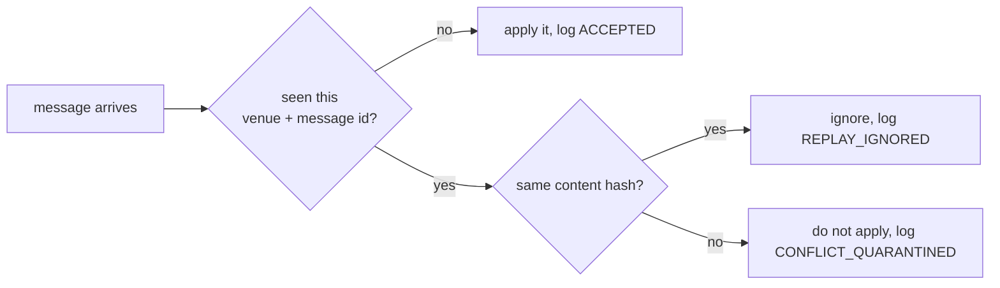

Fills are additionally keyed by `(venue, venue_fill_id)`. Corrections and cancellations do not
overwrite anything; they add a new **version** row, and the current state is a SQL view. In
the baseline run, 150 exact replays were delivered and all 150 were absorbed without touching
a position. Operations' repairs go through **the same gate**, so a repair that is accidentally
submitted twice is also harmless.

---

## 4. How reconciliation works

Reconciliation runs on the bus clock and is only allowed to see what a real middle office
would see: our books, the counterparties' records, public prices and the exception queue
itself. A unit test fails the build if the reconciliation, capture or ops modules ever
reference the simulator's ground truth.

| Control | When | Compares | Finds |
|---|---|---|---|
| **T+0 trade recon** | every 15 min + after the close | our fills vs each venue's drop copy, keyed by `venue_fill_id`, only up to the venue's **coverage watermark** | missing trade, duplicate fill, quantity mismatch, price mismatch (tolerance: half a tick) |
| **Fee recon** | same runs | the fee our negotiated schedule says vs the fee the venue billed | fee mismatch |
| **Confirmation recon** | 21:05 | allocations vs confirmations received by the 21:00 cutoff | late confirmation |
| **Settlement recon** | 19:30 | contractually due settlements vs custodian status messages | failed settlement |
| **EOD position recon** | 19:30 | each fund's holdings at each custodian vs our settled positions | stale position, wrong-account allocation, unexpected position |
| **Cash recon** | 19:30 | each fund's cash per currency at each custodian vs our settled cash (incl. accrued interest and futures variation margin) | any unexplained cash difference |
| **Cross-venue net position** | report | firm-wide net per instrument across custodians (`v_cross_venue_net`) | where a position is held |

**The coverage watermark** stops a common false alarm. A fill that happened at 14:59 is not
"missing at the venue" if the venue's latest file only covers trading up to 14:45. Each drop
copy states the time it vouches for, and trades after that are not compared yet.

**Explaining differences instead of multiplying them.** One root cause shows up in many
places. A quantity typo at 11:00 is a trade break at 11:15, a position difference that
evening, and a cash difference on settlement day. Raising three exceptions for one problem
buries operations in noise. So the position and cash controls first build an
**expected-external model**: our books, adjusted by the known effect of every break that is
already open. For example, an order with an open trade break is re-allocated from the venue's
version of the fills, and an open failed settlement is treated as not yet settled. Only the
**residual** the model cannot explain becomes a new position or cash break.

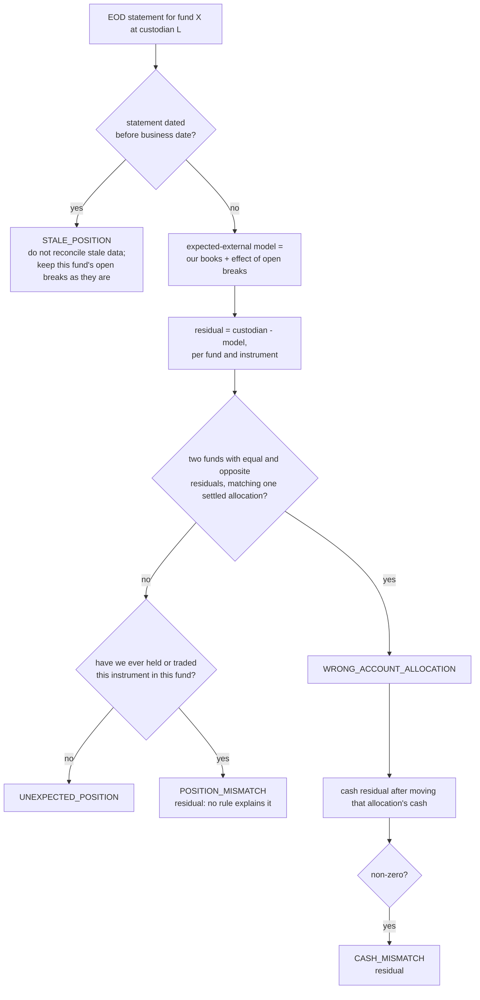

Duplicate fills are told apart from genuinely unknown trades by shape: an internal fill the
venue never reported that has the same order, quantity and price as a matched fill, within
five seconds, is a duplicate.

---

## 5. The exception queue and the ops desk

Every break becomes an exception (`src/tlr/exceptions.py`) with:

| Field | Example |
|---|---|
| severity | `CRITICAL` (≥ $1M impact), `HIGH` (≥ $100k), `MEDIUM` (≥ $5k), `LOW`. Some types have a floor, e.g. a wrong-account booking is never below `MEDIUM`. |
| owner | Trade Support, Middle Office - Fees, Settlements, Position Control, Treasury Ops |
| status | `OPEN` → `INVESTIGATING` → `FIX_APPLIED` / `PENDING_EXTERNAL` / `ESCALATED` → `RESOLVED` or `AUTO_CLEARED` |
| age | from first detection, on the simulated clock |
| source records | the internal and external records that disagreed |
| expected vs actual | e.g. `qty 5000000` vs `qty 50000000` |
| resolution action | e.g. "Corrected internal fill quantity to venue-confirmed quantity" |
| audit history | every state change, with time, actor and note |

A break seen on every 15-minute run stays **one** exception, so its first-seen time is its
detection time. Operations never closes an exception by declaring it fixed. It applies a fix,
and the **next reconciliation run must confirm** the records now agree. An exception that goes
away without anyone acting (a late confirmation that finally arrives, a failing trade that
settles) is marked `AUTO_CLEARED`.

The simulated ops desk works 08:00 to 18:30 on business days and applies the standard remedy
for each type:

| Break | Remedy | Where it goes |
|---|---|---|
| missing trade | book the fill from the venue's drop copy | our books (through the idempotent gate) |
| duplicate fill | bust the duplicate | our books |
| quantity / price mismatch | correct to the venue-confirmed value | our books, then re-allocate and amend SSIs |
| fee mismatch | dispute with the venue and wait for the fee credit (2 to 4 days) | counterparty |
| wrong-account allocation | instruct a custody journal | custodian |
| stale position | request a statement re-send, then re-run the recon | custodian |
| unexpected position | open an investigation; custodian reverses the misbooking | custodian |
| failed settlement, late confirmation | chase the counterparty, monitor | clears itself when the counterparty acts |
| residual position/cash | escalate | stays open |

---

## 6. Injecting problems and scoring the result

The simulator (`src/tlr/world.py`) first generates a clean trading history, then injects
incidents at controlled points. Each is recorded in a ground-truth ledger that only the
scoring harness reads:

| Incident | How it is injected |
|---|---|
| missing trade | a real-time execution report is dropped; the venue's drop copy still has it |
| duplicate fill | the venue re-sends an execution under a **new** exec id seconds later, so idempotency cannot catch it |
| quantity mismatch | the real-time message carries a wrong quantity (plus one **material** 10x fat-finger on a bond) |
| price mismatch | the real-time price is 5 to 40 ticks off |
| fee mismatch | the venue bills off-schedule |
| wrong-account allocation | the custodian settles one fund's allocation into another fund |
| stale position | a custodian statement carries the previous day's balances |
| failed settlement | the counterparty fails to deliver for 1 to 2 days |
| late confirmation | the confirmation arrives 1 to 2 business days after the cutoff |
| unexpected position | the custodian books a holding we never traded |
| *benign noise* | 150 exact message replays, binary-float price artefacts, DST-shifted local timestamps, drop-copy lag. **None of these may create an exception.** |

**Scoring.** An exception *matches* an incident when they share an identifier (a fill id, an
allocation id, a fund and instrument at a custodian, or a statement). Then:

* **Recall** = incidents with at least one matching exception of the **right type** / incidents injected.
* **Precision** = exceptions that match an incident with the right type / all exceptions raised.
* **False positive** = an exception matching no incident (including any raised on benign noise).
* **Detection latency** = exception creation time − the moment the problem became observable
  (the fill time for trade breaks, the 16:00 status for fails, the statement time for custody
  breaks, the cutoff for confirmations).

Two further runs isolate the material incident with reconciliation off and on, and a full
baseline run with **reconciliation disabled** shows how far the injected errors propagate.

---

## 7. Results, figure by figure

All figures are regenerated by `python -m tlr all`.

### Breaks by type

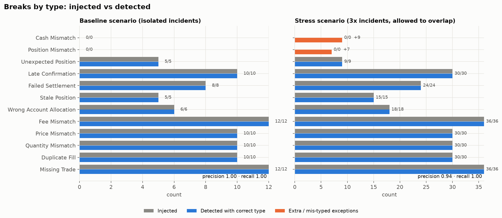

Grey is what was injected, blue is what was detected with the correct type, orange is
anything extra or mis-typed. On the left (isolated incidents) every bar matches. On the right
(stress) every incident is still found, but overlapping root causes produce residual
`CASH_MISMATCH` and mis-typed `POSITION_MISMATCH` exceptions. That is the honest boundary of a
rule-based classifier, discussed in [ANALYSIS.md](ANALYSIS.md).

### Reconciliation status over time

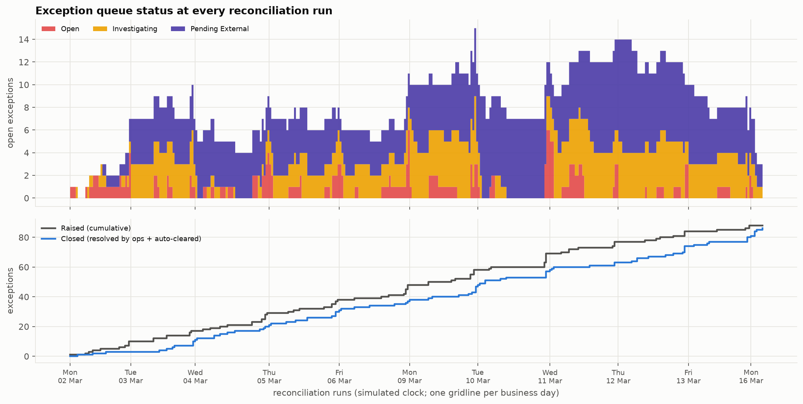

Top: how many exceptions are open at each run, by workflow state. Red (`OPEN`, nobody has
looked yet) appears mostly in the evening after the EOD controls run and is picked up next
morning. Purple (`PENDING_EXTERNAL`) is work waiting on a counterparty: fee credits, custody
journals and reversals. Bottom: raised vs closed. The gap between the lines is the backlog.

### Positions and cash, with and without reconciliation

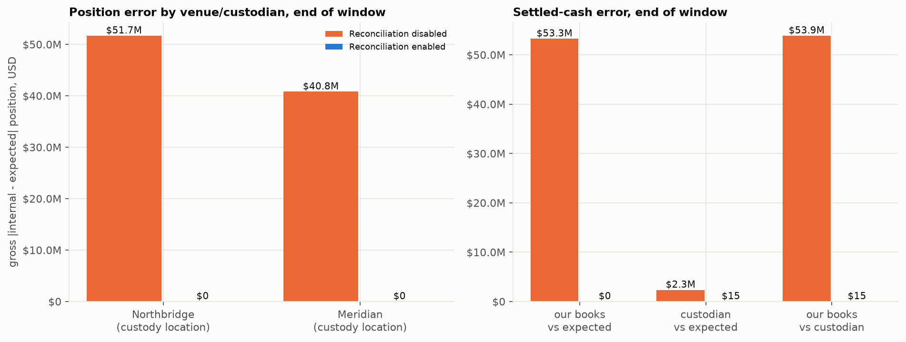

The same 10 days with the same incidents, run twice. With reconciliation **disabled**, the
gross position error sits at both custody locations and cash is out by tens of millions. With
it **enabled**, our books end the window matching the expected state exactly. The only
remaining custodian-side difference is fee credits the venues have not issued yet. Those
exceptions are still open, which is correct.

### Exception aging

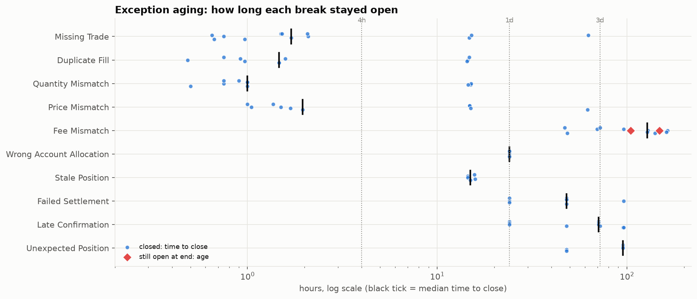

Each dot is one exception, placed at how long it stayed open (log scale). Trade breaks we can
fix ourselves close in about an hour or two. Breaks raised by the evening controls wait for
the next morning. Breaks that depend on a counterparty (fee credits, custody reversals,
failing trades) take days. Red diamonds are still open at the end of the window.

### Detection latency

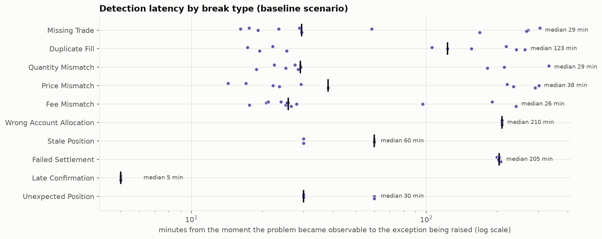

Trade breaks are found within one drop-copy cycle. That is minutes for AlphaX (files every
15 min), up to about an hour for BondHub (hourly) and up to several hours for Meridian (twice
a day). Custody breaks are found at the 19:30 run after the statements arrive. Shortening
detection means getting counterparties to send data more often, not running the recon more
often.

### The material incident: what happens when nobody is looking

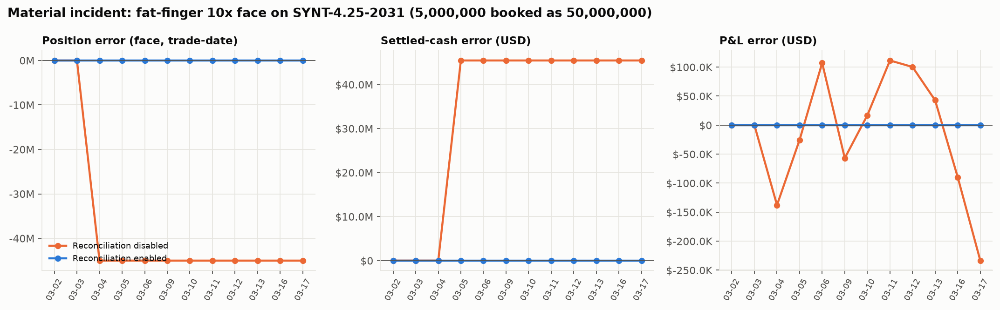

A 5,000,000-face bond sale is booked as 50,000,000. With reconciliation **enabled** (blue),
the T+0 trade recon flags it as a `CRITICAL` quantity mismatch at the next run after the
venue's file covers it, Trade Support corrects the fill, the block is re-allocated, the
settlement instructions are amended, and the re-run confirms the books agree, all on trade
date. With reconciliation **disabled** (orange), the error flows into the allocation, the
settlement instructions, the position (−45M face from trade date), settled cash (+$45M on
settlement date: we expect to receive money for bonds we never sold) and every day's P&L, and
it is still there at the end of the window.

---

## 8. Run it

Requires Python 3.11+.

```bash
pip install -e ".[dev]"
```

Reproduce every number, table and figure in this repository (about 2 minutes):

```bash
python -m tlr all
```

This runs five simulations (baseline with recon on, baseline with recon off, the material
incident in isolation off and on, and the stress scenario), then writes:

* `out/tlr.duckdb`: the full database for the baseline run (plus `tlr_recon_off.duckdb` and `tlr_stress.duckdb`)
* `results/results.json`: every metric; `results/exception_queue.csv`, `exception_audit.csv`, `incidents_baseline.csv`
* `docs/figures/*.png`, the results block in this README, and [SQL_EXAMPLES.md](SQL_EXAMPLES.md)

Run the tests (about 2 minutes; most of that is end-to-end simulations):

```bash
python -m pytest -q
```

Run a single scenario and print its scorecard:

```bash
python -m tlr run --stress --orders-per-day 200
```

Explore the data:

```bash
python -c "import duckdb; print(duckdb.connect('out/tlr.duckdb').sql('SELECT * FROM v_recon_summary'))"
```

Every run is deterministic: the same seed produces byte-identical results. CI re-runs the
whole pipeline on every push and fails if `results/results.json` or the README results block
would change.

**What the tests cover** (`tests/`): exact-duplicate replay is idempotent; conflicting
re-use of a message id is quarantined; partial fills aggregate to the right cumulative
quantity and VWAP; position and cash conservation through allocation on random blocks; fee
arithmetic (half-up cents, basis points, per-contract components); settlement dates across
weekends, holidays, T+0/T+1/T+2; day counts and accrued interest; DST-correct timestamp
normalization; every adapter round-trips; clean records create zero breaks; each of the ten
break types is detected and correctly classified when injected alone; all of them together
are detected and resolution restores the expected state exactly (internal **and** custodian
side); the material discrepancy propagates with recon off and is caught with it on; runs are
deterministic; and the recon engine never reads ground truth.

---

## 9. Repository map

```
src/tlr/
  model.py         normalized domain types (Decimal money, UTC timestamps)
  refdata.py       synthetic security master, accounts, cross-references, fee schedules
  calendar.py      business days, settlement cycles, New York time, 30/360 and ACT/ACT
  bus.py           MessageBus protocol + deterministic in-process implementation
  adapters/        alphax (FIX), bondhub (CSV), meridian (JSON), northbridge (SWIFT-style)
  capture.py       gateway, idempotency gate, OMS state, versioned fills, allocation, SSIs
  allocation.py    block allocation with exact cent conservation
  ledger.py        positions, cash, NAV as pure functions of bookings
  recon.py         reconciliation engine and schedule
  exceptions.py    exception queue, workflow, audit trail
  ops.py           simulated operations desk
  world.py         the simulated venues, custodians and incident injection
  pipeline.py      wiring + the measurement harness
  metrics.py       precision / recall / latency / book differences
  figures.py, report.py, cli.py
  sql/schema.sql, sql/views.sql
tests/             unit, adapter and end-to-end tests
results/           generated metrics and exports (committed)
docs/figures/      generated figures (committed)
```

Further reading: [ANALYSIS.md](ANALYSIS.md) (what the results mean and where the approach
breaks), [SQL_EXAMPLES.md](SQL_EXAMPLES.md) (net positions, unmatched fills, aged exceptions,
EOD cash, reconciliation summary, time-travel queries), [DATA_DICTIONARY.md](DATA_DICTIONARY.md)
(every table and column), [RESUME_BULLETS.md](RESUME_BULLETS.md).

---

## 10. Design choices and limitations

* **Event-driven, no infrastructure.** Components only `publish` and `subscribe`. The
  in-process bus is a deterministic discrete-event scheduler. Kafka or NATS could replace it
  by implementing the same two methods: topics map to topics or subjects, the event key (e.g.
  the venue) becomes the partition key, and every consumer is already idempotent, so
  at-least-once delivery is safe.
* **Append-only storage.** Fills, venue records, allocations and SSIs are never updated in
  place. Corrections are new versions and "current" is a view, so any past moment can be
  replayed in SQL (see SQL example 4). Tables are plain SQL types that port directly to
  PostgreSQL; the views use a few DuckDB conveniences (`EXCLUDE`, `GROUP BY ALL`,
  `date_diff`) that have straightforward PostgreSQL equivalents.
* **Rule-based classification on purpose.** Every break type has an explicit, explainable
  rule, because operations teams need to know *why* something was flagged. The stress
  scenario shows the cost: when root causes overlap, rules mis-attribute some residuals.
* **The simulation is simpler than reality.** There are no corporate actions, no FX trades
  (EUR P&L uses a fixed synthetic rate of 1.08), no partial settlements, no securities
  lending, no SSI mismatches at the depository, and no counterparty-initiated corrections.
  Venues are always the authority on trade economics. Confirmation recon checks timeliness,
  not content (content differences surface in trade recon). Coupon dates fall outside the
  window. Fee schedules, prices and volumes are invented.
* **Perfect baseline scores are a property of the setup, not a claim about production.** The
  incident taxonomy and the classifier were designed together, and baseline incidents do not
  overlap. The stress scenario and [ANALYSIS.md](ANALYSIS.md) exist to make that limit visible.

MIT licensed. All data is synthetic.
